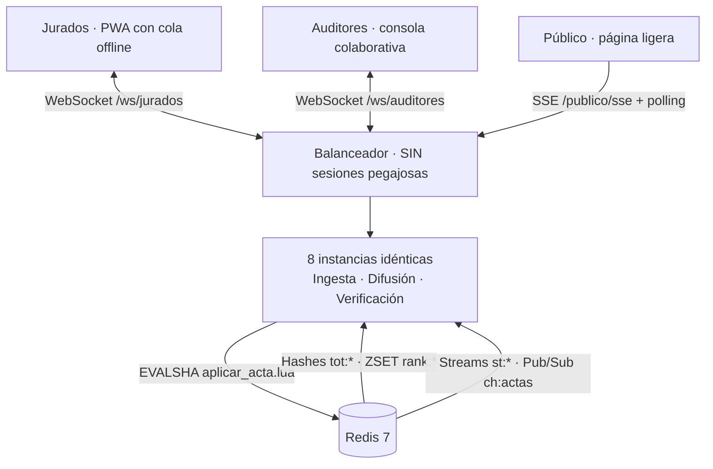

# VOTACIONES · Preconteo electoral en tiempo real

Sistema para una jornada electoral departamental: **6.400 mesas**, **1.842 puestos**, hasta **400.000 navegadores** y **120 auditores**, atendidos por **8 instancias Node.js sin sesiones pegajosas** que solo se coordinan mediante **Redis**.

> Taller de WebSockets · Programación Orientada a la Web · Ingeniería de Software, séptimo semestre.

## Equipo

| Integrante | Rol | Responsabilidad |
|---|---|---|
| Santiago Arévalo | Persona A · Ingesta y consistencia | Jurados, `aplicar_acta.lua`, idempotencia, correcciones y acumulados (RF-1, RF-2, RF-3, RT-6) |
| David Ramírez | Persona B · Difusión pública | SSE/WS/polling, fan-out, continuidad, contrapresión y jitter (RF-4, RF-5, RF-6, RF-9, RT-4, RT-5, RT-9) |
| Camila Zambrano | Persona C · Verificación y plataforma | Auditores, bloqueo, presencia, despliegue, métricas y carga (RF-7, RF-8, RT-1, RT-2, RT-3, RT-7, RT-8, RT-10) |

## Arquitectura



Un acta sigue este recorrido integrado:

```mermaid
sequenceDiagram
    autonumber
    participant J as Jurado (PWA)
    participant IA as Instancia X
    participant R as Redis
    participant IB as Instancia Y
    participant P as Público (SSE)

    J->>IA: acta {idem, version, votos}
    IA->>R: EVALSHA aplicar_acta.lua
    Note over R: Valida, aplica deltas y escribe<br/>acumulados, recibo y streams
    R-->>IA: REGISTRADA + recibo
    IA-->>J: recibo; el acta sale de IndexedDB
    R-->>IB: aviso en ch:actas con tópicos e ids
    Note over IB: Agrega por ventana, lee XRANGE<br/>y condensa N actas en un evento
    IB->>P: delta por tópico, en lotes
```

## Estructura

| Carpeta | Contenido | Dueño |
|---|---|---|
| `shared/` | Contrato de actas, recibos, tópicos, streams y eventos | Los tres |
| `server/src/ingesta/` | Ingesta HTTP/WS y consolidación en Redis | A |
| `server/src/difusion/` | Agregación, continuidad y fan-out público | B |
| `server/src/infra/` | Aplicación modular, Redis, salud y upgrades | Compartido |
| `jurado/` | PWA con cola offline en IndexedDB | A |
| `herramientas/` | Catálogo y jornada simulada mediante la ingesta real | A |
| `publico/` | Página pública de resultados | B |
| `carga/` | Alimentador sintético y herramientas de medición | B / C |
| `docs/` | Diseño, contrato e informes | Los tres |

## Ejecutar

Requisitos: Node.js ≥ 22 y Docker.

```bash
npm install
npm run redis:up
npm run catalogo --workspace @preconteo/herramientas
npm run build
npm start
```

En desarrollo, cada proceso se arranca en una terminal distinta:

```bash
npm run dev           # instancia integrada: ingesta + difusión + verificación
npm run dev:console   # consola de auditores
npm run dev:jurado    # PWA del jurado
npm run dev:publico   # página pública
```

La PWA del jurado y la página pública redirigen sus rutas al servidor local del puerto 3000. La página pública compilada también queda disponible en `GET /publico/` desde la propia instancia.

## Rutas

| Ruta | Uso |
|---|---|
| `POST /actas` | Ingesta HTTP con recibo inequívoco |
| `GET /actas/:id` | Estado vigente de un acta |
| `WS /ws/jurados` | Canal principal de los jurados |
| `GET /publico/` | Página pública (`?mun=11`, `?pue=176`, `?transporte=sse\|ws\|poll`) |
| `GET /publico/sse?topics=dep,mun:11&cursor=...` | Server-Sent Events |
| `GET /publico/poll?topics=...&cursor=...` | Polling de respaldo |
| `WS /ws/publico?topics=...&cursor=...` | WebSocket público para comparación |
| `GET /publico/stats` | Conexiones, mensajes y retraso del Event Loop |
| `GET /whoami` | Identificador de la réplica |
| `GET /live`, `GET /ready` | Sondas de proceso y disponibilidad |
| `GET /metrics` | Métricas Prometheus |

## Garantías de ingesta y difusión

- **Idempotencia:** cada envío conserva su `idem`; los reenvíos reciben el recibo original y nunca duplican votos.
- **Convergencia:** gana la versión más alta; las correcciones aplican deltas y los conflictos pasan a verificación.
- **Offline:** la PWA conserva el acta en IndexedDB hasta recibir una respuesta final, incluso tras recargar sin red.
- **Agregación:** un mensaje por tópico y ventana, con valores absolutos al final de la ventana.
- **Continuidad:** cursor por tópico (`tópico@idDeStream`), común a todas las instancias; la recuperación usa Streams, no Pub/Sub.
- **Explicación de retrocesos:** las entradas distinguen correcciones, retiros dudosos y verificaciones.
- **Contrapresión:** clientes atrasados reciben una fotografía o se desconectan con orden de reconexión.
- **Degradación:** `/ready` devuelve 503 si Redis no está disponible, `/live` permanece activo y los clientes reintentan con full jitter.

## Pruebas

```bash
npm test
npm run typecheck
npm run build
npx playwright install chromium
npm run test:e2e
```

Las pruebas cubren el contrato, ingesta contra Redis real, difusión, persistencia IndexedDB y los escenarios de navegador. Para medir la difusión sin la ingesta real también está disponible:

```bash
npm run alimentar --workspace @votaciones/carga -- --redis=redis://localhost:6379 --acelerar=60 --reiniciar
```

## Documentación

- [Contrato compartido](docs/contrato.md)
- [Arquitectura](docs/arquitectura.md)
- [Despliegue en Azure Container Apps](docs/despliegue-azure.md)
- [Traspaso y pendientes (4 nov 2026)](docs/TRASPASO.md)
- [Informe de ingesta](docs/informe-ingesta.md)
- [Flujo de trabajo con Git](docs/FLUJO_GIT.md)
- [Cómo contribuir](CONTRIBUTING.md)

## Verificación y entorno local (Persona C)

```sh
docker compose up -d --build
docker compose run --rm seed
```

Consola: [localhost:8080](http://localhost:8080). Página pública: [localhost:8080/publico/](http://localhost:8080/publico/). Ana y Luis permiten probar la toma exclusiva en pestañas separadas; Coordinación muestra las réplicas. Cada instancia ejecuta B y C en el mismo servidor.

Con Node 22 y Redis de pruebas en el puerto 6380: `npm ci` y `npm run check`. Las pruebas de navegador requieren Chrome: `npm run test:browser`.

Las resoluciones permanecen en `PENDING_A` hasta conectar la aplicación atómica de A. Los comandos, contratos y resultados están en [docs/plataforma.txt](docs/plataforma.txt), [docs/contratos.txt](docs/contratos.txt), [docs/pruebas.txt](docs/pruebas.txt) y [docs/integracion.txt](docs/integracion.txt). La carga completa de 20.000 conexiones sigue pendiente.
