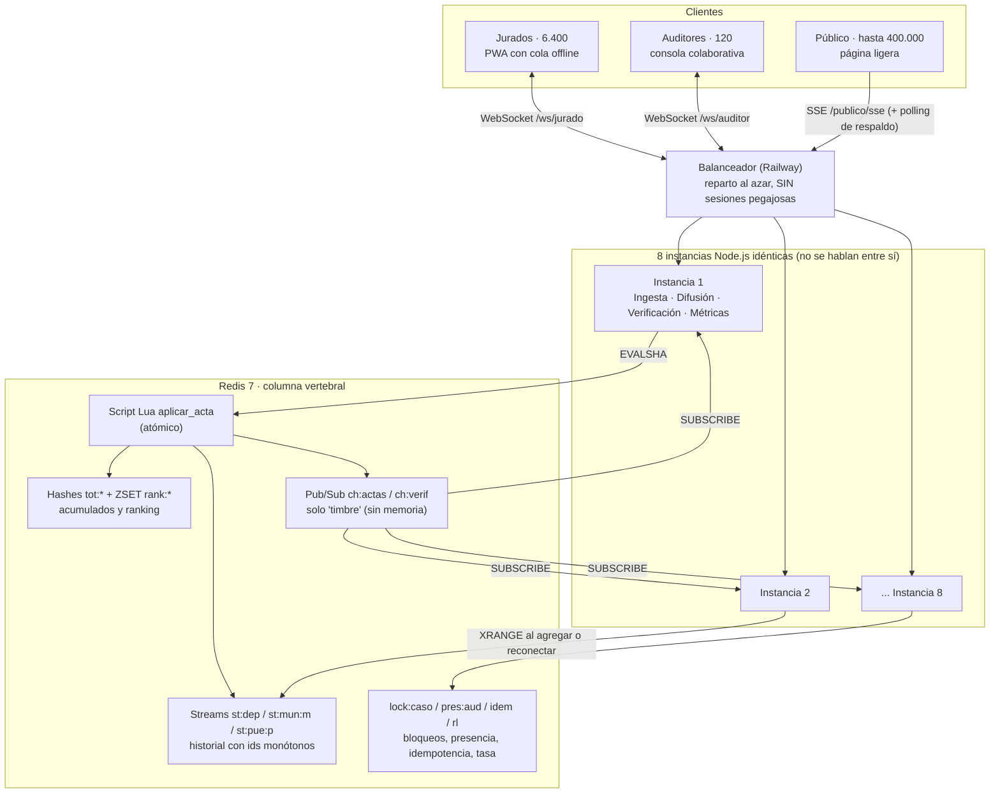

# VOTACIONES · Preconteo electoral en tiempo real

Taller de WebSockets · Programación Orientada a la Web · Ingeniería de Software, séptimo semestre.

Un acta que entra debe llegar, con garantías distintas, a tres audiencias (jurados, auditores y público),
atravesando **8 instancias de Node.js sin sesiones pegajosas** que solo se coordinan por **Redis**.

| Integrante | Rol | Responsabilidad |
|---|---|---|
| Camila Zambrano | Persona A · Ingesta y consistencia | Jurados, `aplicar_acta.lua`, idempotencia, correcciones, acumulados (RF-1, RF-2, RF-3, RT-6) |
| David Ramírez | Persona B · Difusión pública | Público: SSE/WS/polling, fan-out por lotes, continuidad, contrapresión, jitter (RF-4, RF-5, RF-6, RF-9, RF-10, RT-4, RT-5, RT-9) |
| Santiago Arévalo | Persona C · Verificación y plataforma | Auditores, bloqueo y presencia, despliegue con 8 réplicas, métricas, carga (RF-7, RF-8, RT-1, RT-2, RT-3, RT-7, RT-8, RT-10) |

## Arquitectura



### Recorrido de un acta

```mermaid
sequenceDiagram
    autonumber
    participant J as Jurado (PWA)
    participant IA as Instancia X
    participant R as Redis
    participant IB as Instancia Y
    participant P as Público (SSE)

    J->>IA: acta {idem, version, votos} por WebSocket
    IA->>R: EVALSHA aplicar_acta.lua
    Note over R: valida, compara versión, aplica delta en<br/>mesa/puesto/municipio/departamento,<br/>XADD a los streams, PUBLISH ch:actas
    R-->>IA: REGISTRADA + recibo
    IA-->>J: recibo (el acta sale de la cola local)
    R-->>IB: aviso en ch:actas (tópicos tocados)
    Note over IB: marca el tópico "sucio"; cada 2 s (5 s el departamental)<br/>lee XRANGE desde su último id y condensa
    IB->>P: UN mensaje por tópico y ventana, enviado por lotes
```

## Estructura del repositorio

```
VOTACIONES/
├── shared/      Contrato común: tópicos, claves de Redis, canales y formatos de mensaje
├── server/      Instancia Node.js (Fastify + ws). Cada persona tiene su módulo:
│   └── src/
│       ├── infra/         Esqueleto común: Redis, salud, upgrades WS, módulos
│       ├── ingesta/       Persona A
│       ├── difusion/      Persona B
│       └── verificacion/  Persona C
├── publico/     Página pública (Persona B)
├── jurado/      PWA del jurado (Persona A)
├── consola/     Consola de auditores (Persona C)
└── carga/       Pruebas de carga y herramientas de medición
```

## Cómo ejecutar

Requisitos: Node.js 22 y una URL de Redis (el de Railway sirve también para desarrollo).

```bash
npm install
cp .env.example .env      # y poner REDIS_URL
npm run build
npm start                 # producción
npm run dev               # desarrollo con recarga
npm test
```

Rutas comunes de cada instancia: `/whoami` (RT-1), `/live`, `/ready` (503 si Redis no responde), `/metrics` (Prometheus).

## Flujo de trabajo con Git

Ver [docs/FLUJO_GIT.md](docs/FLUJO_GIT.md).
