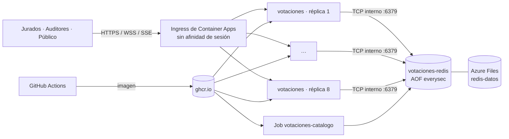

# Despliegue en Azure Container Apps

El grupo descartó Railway por costo. Se usa **Azure Container Apps** (plan de consumo) con el crédito de **Azure for Students** (100 USD por 12 meses, sin tarjeta).

## Arquitectura



| Recurso | Para qué | Requisito |
|---|---|---|
| `votaciones` (Container App) | N réplicas idénticas de la instancia (A+B+C). Ingress externo HTTPS con `transport: auto` (HTTP/1.1 + WebSocket; SSE es HTTP normal) y `stickySessions: none` | RT-1, RT-2 |
| `votaciones-redis` (Container App) | Redis 7, una réplica, solo TCP interno (`votaciones-redis:6379`) con contraseña. AOF `everysec` en Azure Files | RT-3 |
| `votaciones-catalogo` (Job manual) | Carga las 6.400 mesas y la asignación jurado → mesa | RT-10 |
| Log Analytics | Logs de las réplicas (`LOG_LEVEL=warn` para no gastar) | — |
| Imagen en `ghcr.io` | La publica [`imagen.yml`](../.github/workflows/imagen.yml) en cada push a `main`. GHCR es gratis; Azure Container Registry cobra | — |

**Identificador de réplica (RT-1).** Container Apps define `CONTAINER_APP_REPLICA_NAME` en cada réplica. La instancia lo usa como `instancia` en `/whoami`, en cada respuesta (`X-Instance-Id`) y en cada mensaje (ver `idDeReplica()` en `server/src/config/AppConfig.ts`).

**Sondas.** `/live` siempre responde 200, así Container Apps no reinicia las réplicas en bucle si Redis cae. `/ready` responde 503 sin Redis y el ingress deja de enviarle tráfico (RF-10).

**Conexiones largas.** El ingress corta las conexiones inactivas. SSE envía un latido cada 15 s y el WebSocket hace ping/pong cada 15 s, así que nunca quedan inactivas. La rotación SSE de 12–14 min que B diseñó para Railway sigue siendo inofensiva.

## Costo

Precios de referencia (verifíquelos en la [calculadora de Azure](https://azure.microsoft.com/pricing/details/container-apps/)):

- 0,000024 USD por vCPU·s activo y 0,000003 USD por vCPU·s inactivo.
- 0,000003 USD por GiB·s de memoria.
- Gratis cada mes: 180.000 vCPU·s, 360.000 GiB·s y 2 millones de solicitudes.

Una réplica cuenta como inactiva cuando casi no usa CPU ni red.

| Configuración | Estimado por mes |
|---|---|
| 1 réplica de 0,5 vCPU / 1 GiB + Redis, 24/7, casi inactiva | ≈ 10–15 USD |
| 8 réplicas + Redis, 24/7, casi inactivas | ≈ 50–60 USD |
| 8 réplicas durante 3 h de carga intensa | ≈ 1–2 USD |

**Regla del grupo:** 1 réplica en el día a día; `escalar.ps1 -Replicas 8` solo para pruebas de carga y la sustentación, y volver a 1 al terminar. Con eso el crédito alcanza para todo el semestre.

## Primer despliegue

Desde Windows, en PowerShell, en la raíz del repositorio:

```powershell
# 1. Azure CLI e inicio de sesión con la cuenta de estudiante
winget install -e --id Microsoft.AzureCLI      # abrir otra terminal después
az login

# 2. Imagen: hacer push a main o lanzar el workflow "Imagen" en GitHub (Actions → Imagen → Run workflow).
#    La primera vez, en GitHub → Packages → votaciones → Package settings, cambiar la visibilidad a Public
#    (la imagen no contiene secretos). Si se prefiere privada, ver "Imagen privada".

# 3. Desplegar y cargar el catálogo
./deploy/azure/desplegar.ps1 -CargarCatalogo
```

El script:

1. Registra los proveedores necesarios.
2. La primera vez genera `deploy/azure/.secretos.local.json`, que no se versiona. Contiene la contraseña de Redis, `JURADO_SECRETO`, `METRICS_TOKEN` y las credenciales de los auditores Ana, Luis y Coordinación. **Compártanlo entre los tres por un canal privado**: sin él no se pueden emitir credenciales de jurados.
3. Crea el grupo `rg-votaciones` y despliega [`main.bicep`](../deploy/azure/main.bicep).
4. Imprime la URL pública.

Rutas de la URL pública:

| Ruta | Uso |
|---|---|
| `/` | Consola de auditores (credenciales del archivo de secretos) |
| `/publico/` | Página pública |
| `/jurado/` | PWA del jurado |
| `/whoami` | Réplica que atendió (RT-1). Recargar varias veces muestra réplicas distintas |
| `/metrics` | Prometheus (`Authorization: Bearer <metricsToken>`) |

**Credenciales de jurados** con el mismo secreto:

```powershell
$env:JURADO_SECRETO = (Get-Content deploy/azure/.secretos.local.json | ConvertFrom-Json).juradoSecreto
$env:BASE_URL = '<url del despliegue>'
npm run credenciales -w @preconteo/herramientas -- --desde 1 --hasta 20 > credenciales.csv
```

Cada fila trae un enlace `…/jurado/#credencial=…` listo para un código QR.

## Operación

```powershell
./deploy/azure/escalar.ps1 -Replicas 8        # antes de la prueba de carga / sustentación
./deploy/azure/escalar.ps1 -Replicas 1        # al terminar
az containerapp replica list -n votaciones -g rg-votaciones -o table   # réplicas vivas
az containerapp logs show -n votaciones -g rg-votaciones --follow      # logs
./deploy/azure/desplegar.ps1 -Imagen ghcr.io/santiagotyrsarv/votaciones:<sha>   # fijar una versión
```

**Perder réplicas sin perder datos** (RT-2). Container Apps no permite matar una sola réplica a mano. Hay dos formas de demostrarlo:

- Bajar de 8 a 7 con `escalar.ps1 -Replicas 7`: la réplica retirada cierra sus conexiones y esos clientes reconectan a otra con su cursor.
- Reiniciar la revisión con `az containerapp revision restart -n votaciones -g rg-votaciones --revision <revisión>` (`az containerapp revision list …`): reinicia todas las réplicas.

En ambos casos los totales no cambian, porque todo vive en Redis.

**Borrar todo** (detiene el gasto): `az group delete -n rg-votaciones --yes`.

## Imagen privada

Cree un token clásico de GitHub con `read:packages` y agregue a los parámetros del despliegue `registroUsuario=<usuario>` y `registroToken=<token>`. Por ejemplo, edite el bloque `parameters` de `desplegar.ps1`, o ejecute `az deployment group create … --parameters registroUsuario=… registroToken=…`.

## Riesgos conocidos

- **Redis sobre Azure Files (SMB).** El AOF funciona, pero SMB es más lento que un disco local. Con `everysec` no afecta la latencia de los comandos. Si hubiera problemas de permisos o bloqueos, quitar el volumen deja Redis en memoria; se pierde la persistencia ante reinicios de Redis, pero no la de las réplicas.
- **Región.** Azure for Students limita las regiones disponibles. Si `eastus2` falla, pruebe `-Ubicacion westus2` o `centralus`.
- **20.000 conexiones (RT-8).** Con 8 réplicas de 0,5 vCPU son unas 2.500 conexiones por réplica. Para la prueba de carga conviene `cpu='1'` y `memoria='2Gi'` (parámetros de `main.bicep`) durante la prueba.
